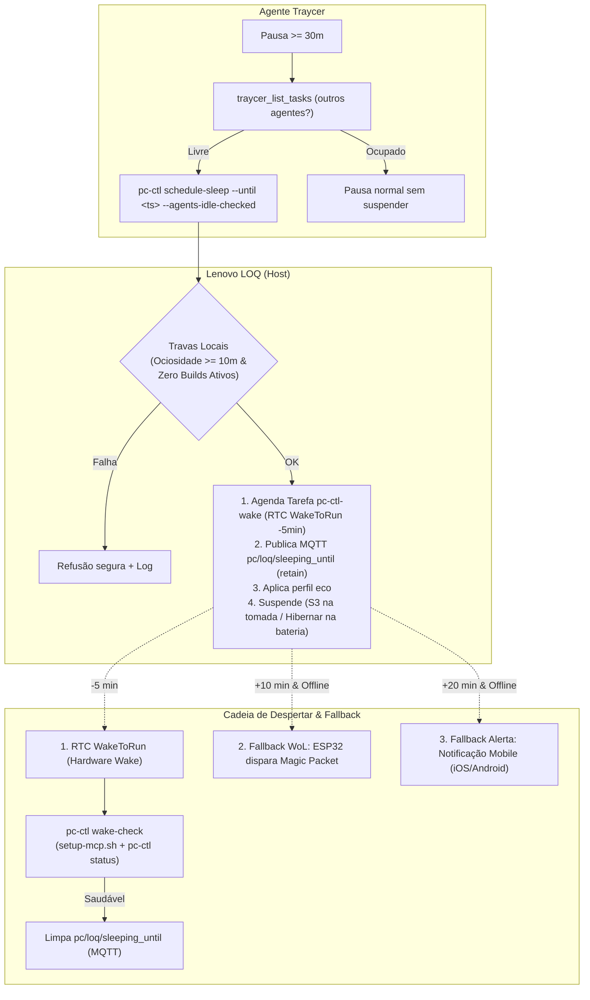

# Home Assistant & Mosquitto MQTT Server (VPS Stack)

Esta pasta contém a stack docker-compose para rodar o **Home Assistant Core** e o **Eclipse Mosquitto (MQTT Broker)** na sua VPS, servindo como o hub de automação e controle remoto da sua estação de trabalho (Lenovo LOQ / Windows 11 + WSL2).

---


> [!TIP]
> Para o procedimento detalhado e o guia de deploy automatizado via SSH / Tailscale com o comando `make ha-vps-deploy`, consulte [VPS_DEPLOY.md](VPS_DEPLOY.md).

## 1. Pré-Requisitos na VPS

1. **Docker e Docker Compose** instalados na VPS.
2. **Tailscale** instalado e autenticado na mesma tailnet do seu PC e smartphone:
   ```bash
   curl -fsSL https://tailscale.com/install.sh | sh
   sudo tailscale up
   ```
3. Anote o IP da VPS no Tailscale (ex: `100.x.y.z` ou via MagicDNS: `vps-nome.sua-tailnet.ts.net`).

---

## 2. Passo a Passo de Instalação na VPS

### Passo 1: Copiar os arquivos para a VPS
Copie esta pasta `homeassistant/` para a VPS (ex: em `/opt/homeassistant` ou `~/homeassistant`):
```bash
rsync -avz ./homeassistant/ usuario@vps-ip:~/homeassistant/
```

### Passo 2: Criar o arquivo de credenciais do Mosquitto
Acesse a pasta na VPS e gere a senha do usuário MQTT (ex: usuário `hass`):
```bash
cd ~/homeassistant
docker compose run --rm mosquitto mosquitto_passwd -c /mosquitto/config/password_file hass
```
*O utilitário solicitará a digitação da senha duas vezes e salvará o hash seguro em `mosquitto/config/password_file`.*

### Passo 3: Criar o `.env`
Copie o template de variáveis de ambiente:
```bash
cp .env.example .env
```
Ajuste o `TZ` caso seu fuso seja diferente de `America/Fortaleza`.

### Passo 4: Subir os Containers
```bash
docker compose up -d
```
Verifique se os containers estão saudáveis:
```bash
docker compose ps
docker compose logs -f
```

---

## 3. Configuração Inicial do Home Assistant

1. Abra o navegador no seu PC ou celular e acesse o endereço do Home Assistant via Tailscale:
   ```
   http://<IP-TAILSCALE-DA-VPS>:8123
   ```
2. Crie sua conta de administrador.
3. Vá em **Configurações (Settings) -> Dispositivos e Serviços (Devices & Services) -> Adicionar Integração**.
4. Procure por **MQTT** e configure com os dados:
   - **Broker**: `127.0.0.1` (ou o IP do Tailscale)
   - **Porta**: `1883`
   - **Usuário**: `hass`
   - **Senha**: A senha definida no Passo 2.
5. Pronto! O Home Assistant agora escuta o broker MQTT com auto-discovery habilitado. Assim que o **HASS.Agent** for iniciado no seu Windows, os sensores e comandos aparecerão automaticamente como entidades no painel.

---

## 4. Configuração no Smartphone (App Oficial)

1. Instale o aplicativo **Tailscale** no seu celular e conecte-se à mesma conta.
2. Instale o app oficial **Home Assistant** (Google Play Store ou Apple App Store).
3. Na primeira inicialização do app, defina a URL do servidor como:
   ```
   http://<IP-TAILSCALE-DA-VPS>:8123
   ```
4. Faça login com suas credenciais.
5. Você terá acesso seguro ao dashboard de controle (botões de desligar, suspender, abrir apps e status do PC) de qualquer lugar do mundo (4G/5G/Wi-Fi externo) através do túnel criptografado do Tailscale.

---

## 5. Integração MCP para Agentes de IA (`ha-mcp`)

O ecossistema dispõe de integração direta entre as CLIs dos agentes de IA (Claude Code, Gemini CLI, Antigravity, OpenCode e Cursor) e o Home Assistant via protocolo MCP utilizando o pacote [`ha-mcp`](https://github.com/homeassistant-ai/ha-mcp) executado isoladamente com `uvx`.

### 5.1. Pré-Requisitos e Credenciais

1. **Geração de Token no Home Assistant**:
   - Acesse o painel web (`http://100.105.143.75:8123` via Tailscale).
   - Clique no perfil do seu usuário no canto inferior esquerdo $\rightarrow$ aba **Segurança**.
   - Em **Tokens de Acesso de Longa Duração**, clique em **Criar Token**.
   - Defina um nome (ex: `agentes-mcp`) e copie o token gerado.

2. **Configuração do Arquivo de Segredos Local**:
   ```bash
   cp secrets/mcp.env.example secrets/mcp.env
   ```
   Edite `secrets/mcp.env` e preencha a variável `HOMEASSISTANT_TOKEN`:
   ```bash
   export HOMEASSISTANT_URL="http://100.105.143.75:8123"
   export HOMEASSISTANT_TOKEN="seu_token_aqui"
   ```
   *(O arquivo `secrets/mcp.env` é estritamente ignorado pelo Git e carregado automaticamente pelo `~/.zshrc`)*.

### 5.2. Verificação de Ambiente e Conectividade

Execute o diagnóstico automatizado para validar a conectividade com o Home Assistant na Tailscale, o utilitário `uvx` e a autenticação do token:

```bash
make ha-mcp-check
# ou diretamente via script/ctl:
./homeassistant/setup-mcp.sh check
bin/ha-mcp-ctl check
```

### 5.3. Configuração dos Clientes de IA

Você pode simular as configurações de forma segura com `--dry-run`:
```bash
make ha-mcp-config DRY_RUN=1
```

E aplicar as configurações nos clientes suportados:
```bash
make ha-mcp-config
```

#### Detalhes por Cliente:

- **Claude Code**:
  Registra o servidor `home-assistant` no escopo do usuário via `claude mcp add`:
  ```bash
  claude mcp add home-assistant -s user \
    -e HOMEASSISTANT_URL="http://100.105.143.75:8123" \
    -e HOMEASSISTANT_TOKEN="<SEU_TOKEN>" \
    -- uvx ha-mcp
  ```

- **Gemini CLI / Antigravity**:
  Adiciona a entrada no arquivo `~/.gemini/config/mcp_config.json`:
  ```json
  "homeassistant": {
    "command": "uvx",
    "args": ["ha-mcp"],
    "env": {
      "HOMEASSISTANT_URL": "http://100.105.143.75:8123",
      "HOMEASSISTANT_TOKEN": "<SEU_TOKEN>"
    }
  }
  ```

- **OpenCode**:
  Snippet para o bloco `mcp` em `~/.config/opencode/opencode.json` (com suporte seguro a `{env:VAR}`):
  ```json
  "homeassistant": {
    "type": "local",
    "command": ["uvx", "ha-mcp"],
    "enabled": true,
    "environment": {
      "HOMEASSISTANT_URL": "{env:HOMEASSISTANT_URL}",
      "HOMEASSISTANT_TOKEN": "{env:HOMEASSISTANT_TOKEN}"
    }
  }
  ```

- **Cursor**:
  Configuração para `~/.cursor/mcp.json` ou `.cursor/mcp.json`:
  ```json
  {
    "mcpServers": {
      "homeassistant": {
        "command": "uvx",
        "args": ["ha-mcp"],
        "env": {
          "HOMEASSISTANT_URL": "http://100.105.143.75:8123",
          "HOMEASSISTANT_TOKEN": "<SEU_TOKEN>"
        }
      }
    }
  }
  ```

## Cadeia de Fallback Wake-on-LAN (Sprint 08)

O Lenovo LOQ opera primariamente via agendamento RTC (`WakeToRun` no Windows Task Scheduler disparado via `pc-ctl schedule-sleep`). Como redundância:

1. **RTC Wake Local**: Mecanismo primário (dispara 5 minutos antes do término da quota/espera).
2. **ESP32 WoL (+10 min)**: Se 10 minutos após o wake previsto o PC ainda não responder no MQTT (`sensor.loq_windows_cargadacpu` indisponível / `binary_sensor.loq_online` off), a automação `loq_wake_fallback_esp32_wol` aciona o botão `button.wake_loq_pc` no firmware ESPHome (`homeassistant/esphome/pc-wol.yaml` via `target_mac_address`).
3. **Notificação Mobile (+20 min)**: Se passados 20 minutos o dispositivo ainda estiver indisponível, a automação `loq_wake_fallback_notify_mobile` dispara um alerta push para o smartphone do usuário via `notify.send_message` direcionado a `notify.iphone_de_flavian`.


